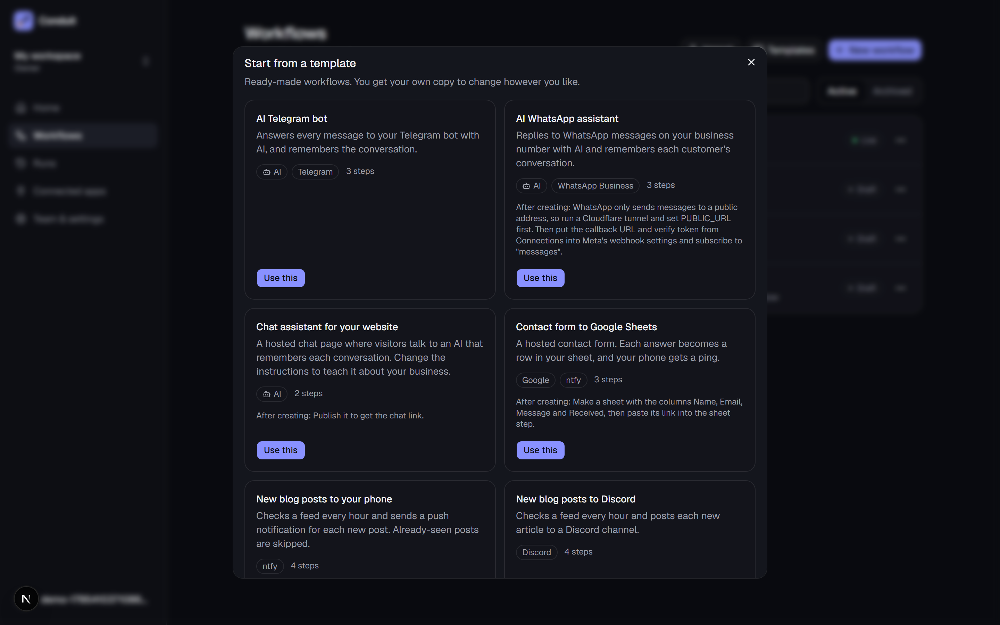

# Conduit

[](https://github.com/dexicism/conduit/actions/workflows/ci.yml)


[](LICENSE)

My own workflow automation tool, kind of like Zapier or n8n, but it runs on my laptop and costs nothing.

You drag steps onto a canvas, connect them, and hit publish. Some things I use it for:

- a Telegram bot that answers messages with AI
- form submissions that land in a Google Sheet
- a little chat page that talks to a workflow
- scheduled jobs that send emails or create calendar events

The AI runs locally through [Ollama](https://ollama.com), so there's no API bill. There are no plans, no credits and no limits either. Everything's just free.


| Editor | Templates |
|---|---|
|  |  |

## What's in it

- **Home page:** how your live workflows did this week: runs per day, success rate, the busiest workflows and the latest failures, with a link straight to each failed run.
- **Templates:** nineteen ready-made workflows to start from (a team assistant on WhatsApp that knows who's boss, a morning nudge about due tasks, an AI supervisor that reports to the owner every evening, a checker that asks the team about stuck leads with hourly follow-up reminders, an email when WhatsApp goes offline, a weekly leads report as Excel, AI bots for Telegram and WhatsApp, an AI assistant on your own WhatsApp number, WhatsApp messages and photos that update your Google Sheet, a chat assistant for your site, a contact form that fills a Google Sheet, new blog posts to your phone or Discord, Telegram to Todoist, bug reports to GitHub, a newsletter sign-up, and failure alerts). Hit **Templates** on the workflows page.
- **Editor:** 50-odd kinds of steps, a settings panel for each one, a picker for pulling data from earlier steps, undo/redo, copy/paste, sticky notes, auto-layout. It auto-saves and won't let two tabs overwrite each other.
- **Version history:** every publish is saved. Open one, restore it into the editor, publish again. There's also **Download as file** and **Import** for sharing a workflow. Accounts, secret fields and auth headers are left out of the file; everything else you typed into steps goes with it, so give it a look before you post it somewhere.
- **Variables:** put things like a phone number or a sheet link in Team & settings once, then use `${['$vars']['NAME']}` in any step. Secret ones are encrypted and show up as `[hidden]` in run logs.
- **Triggers:** manual, webhook, schedule, form, chat page, Telegram, WhatsApp (official API or a linked phone), "called by another workflow", and "on error".
- **Logic:** if/switch, loops, filter, merge, "only new items" (remembers what it's already seen, so a feed check every hour doesn't repeat itself), set fields, text/math/date/JSON helpers, HTTP requests, and a JavaScript step that runs in a sandbox.
- **AI:** an agent that can use tools and remember a conversation (per workflow, or shared by every workflow talking to the same person), plus classify, sentiment, moderation and "pull data out of this text" steps. It reads photos, PDFs and voice notes. There's also a chat builder: describe a workflow and it drafts it on the canvas.
- **Files:** make Excel files, put photos into a PDF, merge PDFs, pick pages, stamp text like APPROVED on a PDF. All of them can send the result on WhatsApp, and the AI agent can use them as tools.
- **Apps:** Telegram, Gmail (send and search), Google Sheets (add, read, find and update rows), Calendar and Drive, Notion, Airtable, Slack, Discord, WhatsApp (Business API, or a normal number linked like WhatsApp Web, groups included), GitHub, Trello, Todoist, Mailchimp, ntfy (push notifications to your phone), RSS feeds, PostgreSQL and SMTP. Any app step can also be handed to the AI agent as a tool.
- **The rest:** run history with every step's input and output, teams with roles, API keys and a REST API, outgoing webhooks, an MCP server so AI assistants can read and edit workflows, and two-step sign-in.

## Running it (Windows, the easy way)

Double-click **Start Conduit** (`Start Conduit.cmd` in this folder). It starts Ollama, the database and the app, then opens http://localhost:3000. The first start takes about a minute. Two minimized "Conduit" windows stay open while it's running.

**Stop Conduit** shuts it all down. Bots and schedules only run while it's up.

**Keep Conduit running** (run it once) adds a small Windows task for your user, no admin needed: Conduit starts when you sign in, and every 5 minutes the database and the app are started again if they've stopped. What it did goes to `.data/watchdog.log`. **Stop Conduit** still means stopped: the watchdog leaves it off until you **Start Conduit** again. `Keep Conduit running.cmd -Remove` turns it off. For a bot that should answer all day, also set Windows to never sleep while plugged in (Settings, System, Power), since a sleeping laptop can't run anything.

The local AI (Ollama) is only started when `AI_PROVIDER=ollama`.

## Running it by hand

You need Node 22.12 or newer. No Docker: the dev database downloads a real `mongod` the first time.

```bash
npm install
npm run db     # MongoDB on 127.0.0.1:27018, leave it running
npm run dev    # http://localhost:3000
```

Copy `apps/web/.env.example` to `apps/web/.env.local` first. The only thing you have to set is `BETTER_AUTH_SECRET`.

Sign-in is by email code. If you haven't set up email (`RESEND_API_KEY` or `SMTP_URL`), the codes show up at http://localhost:3000/dev/outbox instead.

## AI

Three ways to give it a brain. All AI steps and the builder use whichever one you set in `.env.local`.

**Google Gemini (free tier, recommended to start):** get a key at [aistudio.google.com](https://aistudio.google.com), then set `AI_PROVIDER=gemini` and `GEMINI_API_KEY=...`. It's a lot smarter than a local model, it can read pictures (bills, screenshots, handwritten notes), and the free tier is plenty for a small team. On the free tier Google may use what you send to improve its products, so think about that before sending customer data; the paid tier doesn't. `GEMINI_MODEL` picks the model (default `gemini-2.5-flash`). If you hit "too many requests", that's the free-tier limit; wait a minute.

**Ollama (free, offline):** install Ollama, run `ollama pull qwen3:8b`, and put `AI_PROVIDER=ollama` in `.env.local`. Every AI step and the builder will use that model.

A few things I found:

- It needs around 8 GB of free memory. On my laptop (RTX 3050, 4 GB) a reply takes 4 to 8 seconds once the model is loaded.
- It's fine for single AI steps. The builder gets shaky with bigger requests: a 4-step ask once took 3.5 minutes and only added the first step. The builder panel shows which steps it actually added, so check that.
- If Ollama crashes with a "CUDA error" on an NVIDIA laptop GPU, run `setx OLLAMA_LLM_LIBRARY cuda_v12` and restart Ollama. That one took me a while.
- `npx tsx scripts/try-ollama.mts` checks that answers, tool calls and JSON output all work.

**Claude:** set `AI_PROVIDER=anthropic` and `ANTHROPIC_API_KEY` (from platform.claude.com, where you buy API credits; a Claude Pro subscription doesn't work here, that's for chatting in the Claude apps). The smartest of the three and very good at following rules, but you pay per use. To keep that low:

- `ANTHROPIC_MODEL=claude-haiku-5-5` runs every AI step on Haiku, whatever model a step asks for. Without it, steps use the model picked in the step (the default is Opus, which costs far more).
- Prompt caching is on: the instructions and tool list are the same on every message, so after the first one they cost about a tenth. Only the date goes into the instructions (the time goes with each message), so the cache lasts all day.
- Claude reads photos and PDFs. It can't listen to voice notes; if `GEMINI_API_KEY` is set too, Gemini writes each voice note out first and Claude gets the text.

With Gemini, `GEMINI_FALLBACK_MODELS` (default `gemini-2.5-flash-lite`) is tried when the main model is busy or out of free requests; a model that said its quota is used up is skipped for as long as Google says.

The AI Agent and Extract data steps have an **Image** field: give it a WhatsApp media ID (or base64) and the model reads the picture along with the text. Gemini and Claude can; most local models can't. `AI_PROVIDER=fake` gives you a dumb rule-based model for poking around without either.

## Connecting apps

Saved accounts are encrypted. In dev the key is created for you in `.data/encryption.key`. In production, set `CONDUIT_ENCRYPTION_KEY` (32 random bytes, base64) and use the same one everywhere the app runs.

**Telegram:** make a bot with @BotFather and paste its token under Connections. On your own PC the app polls Telegram for new messages, so you don't need a public address. `scripts/telegram-ai-bot.mts` sets up an "AI replies to messages" bot in one go.

**Google (Gmail, Sheets, Calendar, Drive):**

1. Make a project in Google Cloud and enable the Gmail, Sheets, Calendar and Drive APIs.
2. Set up the OAuth consent screen. Leave it in "Testing" and add yourself as a test user.
3. Create an OAuth client ("Web application") with this redirect URI: `http://localhost:3000/api/credentials/oauth/callback`
4. Put the client ID and secret in `.env.local` as `CONNECT_GOOGLE_CLIENT_ID` and `CONNECT_GOOGLE_CLIENT_SECRET`.

Google logs test apps out every 7 days. When that happens, hit **Reconnect** under Connections. Drive can only see files Conduit made itself, which is on purpose. The `scripts/try-google-*.mts` scripts check each Google service against your real account.

**WhatsApp on your own number (linked phone):** works like WhatsApp Web. Add **WhatsApp (linked phone)** under Connected apps, scan the QR code with WhatsApp on that phone (Settings, Linked devices), done. No Meta account, no templates, no 24-hour rule, no public address, and it works in groups (reply to everything, or only when someone @mentions it). Photos and files people send are kept for 30 days and can be passed to other steps or sent back. **Listen to: only people in a sheet tab** makes the trigger read the Phone column of a tab (your Team tab) every 2 minutes and drop everyone else before a run even starts, so on a personal number your friends' and family's chats aren't stored and don't use up Google's sheet limits.

The catch: it isn't Meta's official API, so WhatsApp can ban a number it decides is a bot, and WhatsApp updates sometimes break the link for a few days until the library catches up. Use a number you can afford to lose, warm it up by using it normally for a week or two, keep the volume human, and don't message lots of strangers first. If the number is ever banned or logged out, nothing in Conduit is lost; link a new number. It needs the phone to come online every couple of weeks, and the login lives in `apps/web/.data/whatsapp-web` (keep that folder). Set `WHATSAPP_WEB=0` to switch it off.

**WhatsApp Business (official API):** uses Meta's official Cloud API, so it stays within WhatsApp's rules (unofficial WhatsApp Web bots can get a number banned). Meta's test number is free and can message up to 5 numbers you verify.

1. Make an app at developers.facebook.com, add WhatsApp, and copy the Phone number ID and an access token from API Setup. Connect it under Connections.
2. Sending works right away. For receiving, Meta needs a public address, so start a Cloudflare tunnel (below) and set `PUBLIC_URL`.
3. Hit **Receive messages** on the connection. Add the App secret and a verify token you make up (the key button), then paste the callback URL and the same verify token into Meta (WhatsApp, Configuration) and subscribe to `messages`.
4. Use the "AI WhatsApp assistant" template, or any workflow that starts with "WhatsApp message".

Replies within 24 hours of a customer's message are free-form. After that WhatsApp only allows approved templates, which the send step supports.

**Team roles and permissions:** add a **Team** tab to your Google Sheet with the columns Name, Phone, Role and Access (`edit`, `view` or `blocked`; a role like Owner or Boss is the owner). The **Team access check** step looks up whoever's writing (phone numbers match on their digits, so +91 and leading zeros don't matter) and sends them down *allowed* or *denied*, with their name, role and rights attached. The "Team assistant with roles" template uses it so the owner can do everything (including searching email), editors can update customers, everyone else can only ask, and strangers get nothing. Change who's allowed by editing the sheet.

**Tasks, reminders and "tell everyone":**
- **Task log: add task** writes to a Tasks tab (ID, Task, Customer, Assigned to, Phone, Status, Due, Created by, Created). Before adding, it checks for an open task on the same customer, and if there is one it doesn't add a duplicate; it tells you who's on it ("Ravi is already handling Mehta Traders, due Friday").
- **WhatsApp (linked phone): send later** schedules a message ("tomorrow 9am", "2026-11-28 18:30", "in 2 hours", in your time zone). If Conduit is off at that moment, it goes out as soon as it's back. **Reminders** lists or cancels them.
- **WhatsApp (linked phone): send to many** sends one message to a list of numbers, one at a time with a random 5 to 15 second gap, because instant blasts are what get numbers banned. At most 200 at once.
- AI agents now know today's date and time, so "remind me Friday" works.
- **Task log: due tasks** lists open tasks that are overdue or due soon (it reads 2026-11-28, 28/11/2026 and "28 Nov 2026"), one item per task or one summary with a ready-to-send text.
- **Nudge people about due tasks** (template): every morning, everyone with something due or overdue gets a WhatsApp asking for an update. No AI, so it's free. Their replies reach the team assistant, which can mark the task done or move the date.
- **Supervisor: daily report to the owner** (template): every evening an AI reads all open tasks, asks people whose tasks are more than 2 days late what's going on, and sends the owner a short report. Set the owner's number once as the variable `OWNER_PHONE`.

**PDFs (quotations, invoices, price lists):** **Make PDF document** turns a title, a few lines of text and a table into a clean A4 PDF. Write the table as lines (`Item | Qty | Price`, then one line per item) or pass a list from another step; with quantity and price columns it adds the amounts and a total. **WhatsApp (linked phone): send a PDF** makes it and sends it in one go, which is what the team assistant uses when the owner says "send Mehta a quote for 50 pipes at 200". The built-in PDF fonts can't draw ₹ (it's written as Rs.) or non-Latin scripts (shown as ?).

**Running a team from a sheet (rules, follow-ups, activity):**
- **Google Sheets: read tab as text** reads a tab like *Bot Rules* (one rule per line) for an AI step's instructions. It's kept for 10 minutes, so the owner can change how the bots behave by editing the sheet, without touching the workflow.
- **Log changes to tab** (on *add row* and *update row*) writes every change to an *Activity* tab: When, Who, Tab, Row, Name and what changed from what to what. No AI involved, and a missing tab never breaks the change itself.
- **Follow-ups: ask someone** sends a team member a question on WhatsApp, writes it to a *Follow-ups* tab (ID, Asked At, Person, Phone, About, Question, Status, Reminders, Next Reminder, Answer) and puts it in their shared memory. It won't ask the same thing twice while the first is still waiting. **Follow-ups: remind or give up** (run it hourly) re-asks after the wait and, after the set number of reminders, marks it "No reply" so you can tell the owner. **Follow-ups: mark answered** goes right after a WhatsApp trigger: whatever that person writes counts as the answer.
- **Shared memory** (AI agent, Memory = "Shared"): every workflow talking to the same person adds to one conversation, keyed by their phone number. A checker's question, a morning list or a quotation sent from another workflow (switch on "Add to the person's shared memory" in the send step) is then part of the chat, so a reply like "done" makes sense to the assistant.
- **Search** (find rows): column `any` searches every column, a tab can list several tabs (`Enquiries, Architect Data`), every word has to appear somewhere in the row, and "If nothing matches: look in every column, then close spellings" also offers similar names when there are only a few hits (Rajes finds Rajesh), marked `closeMatch`. Phone numbers match with or without +91, spaces, leading zeros, or two numbers in one cell.
- Numbers written without a country code (like 9812345678 in a sheet) get the **Country code** of the WhatsApp connection (91 by default) instead of going to the wrong person.

**Files:** **Make Excel file** (from a table, the incoming items, or a sheet tab with an optional filter, like "Assigned To contains Ravi"), **Photos to PDF**, **Merge PDFs**, **Pick PDF pages** and **Stamp text on a PDF**. Files come from WhatsApp media IDs, data: URLs or base64; each step can send the result on WhatsApp right away. Given to an AI agent as tools, the file's contents are never sent to the model, only its name and size, so they cost almost nothing. Photos and files people send are remembered in the chat by their media ID, so "make one PDF of the photos I sent" works.

**Gmail search** needs permission to read mail, which older connections don't have: press **Reconnect** on the Google account once.

**Everything else** just needs a key pasted under Connections. The connect dialog says where to find it for each app, but roughly:

- **Notion:** make an internal integration at notion.so/profile/integrations, then add it to each database (••• → Connections). Without that last bit you get "not found".
- **Airtable:** a personal access token with the `data.records` scopes and access to your base.
- **Discord:** a channel webhook URL (Server Settings → Integrations → Webhooks). @mentions are switched off by default so a workflow can't ping @everyone by accident.
- **GitHub:** a fine-grained token with Issues: read and write.
- **Trello:** an API key from a Power-Up, plus a token. The list ID hides in any card's URL with `.json` on the end.
- **Todoist:** your API token from Settings → Integrations → Developer.
- **Mailchimp:** an API key. Adding someone who's already on the list just updates them, so re-running is safe.
- **ntfy:** nothing to sign up for. Install the ntfy app, subscribe to a hard-to-guess topic, and send to it.
- **RSS:** no account at all. Put it after a schedule to watch a blog.

**Webhooks and forms from the internet:** your laptop isn't reachable from outside, so run a free Cloudflare tunnel with `cloudflared tunnel --url http://localhost:3000` and put the address it prints into `PUBLIC_URL`. The address changes every time, and anyone with the link can reach your sign-in page, so close the tunnel when you're done.

## Running it for real

In dev, workflows run inside `npm run dev`. On a server you'd run the worker on its own (`npm start -w worker`, as many copies as you want) and set `CONDUIT_WORKER=off` on the web side. Jobs are claimed with a lease, so two workers never run the same thing.

By default each workspace runs up to 4 workflows at once (`WORKSPACE_CONCURRENCY`) and keeps run logs for 30 days (`EXECUTION_RETENTION_DAYS`). HTTP steps can't hit private network addresses unless you set `HTTP_ALLOW_PRIVATE_NETWORK=1`. If it sits behind a reverse proxy, set `TRUST_PROXY=1` so the chat page can rate-limit by IP.

## Backups

While Conduit runs, it saves a copy of the whole database once a day to `apps/web/.data/backups` (a laptop that was off overnight makes its backup about 30 seconds after starting). The last 14 are kept. Each backup is a folder of gzipped files, one per collection.

To restore: stop Conduit, keep the database running (`npm run db`), then

```bash
npx tsx scripts/restore-backup.mts                 # lists the backups
npx tsx scripts/restore-backup.mts <backup folder> # puts that one back
```

Saved accounts stay encrypted inside backups, so they only work again with the same key: keep a copy of `apps/web/.data/encryption.key` somewhere safe (not next to the backups). For real safety, copy the backups folder to another disk or a cloud drive now and then; a backup on the same laptop doesn't help if the laptop dies. `BACKUP_DIR`, `BACKUP_KEEP`, `BACKUP_EVERY_HOURS` and `BACKUP=0` change or switch this off.

## Tests

GitHub Actions runs the typecheck, lint and unit/integration tests on every push and pull request. The browser tests need a running app, so they run locally.

```bash
npm test            # unit and integration tests
npm run typecheck
npm run e2e         # Playwright; needs `npm run db` running, starts its own app on :3100
```

The tests use fake versions of every app (`packages/runtime/src/testing/fake-apis.ts`), so they run offline and never touch real accounts. Telegram, the Google apps and ntfy have also been checked for real (`scripts/try-*.mts`); the WhatsApp Business API, Notion, Airtable, Discord, GitHub, Trello, Todoist and Mailchimp so far only against the fakes. WhatsApp (linked phone) is tested against a fake socket; the real library is checked up to getting a QR code from WhatsApp, but not yet with a linked phone.

## Where things live

```
apps/web          the Next.js app: pages, API routes, MCP server
apps/worker       the standalone worker for production
packages/core     shared types, schemas, graph validation
packages/nodes    the step definitions (fields, inputs, outputs)
packages/engine   runs a workflow graph step by step (no I/O, easy to test)
packages/runtime  database, job queue, triggers, sandbox, app integrations, AI providers
scripts           start/stop scripts, the dev database, "try it for real" scripts
docs              how it works, the database, the API
```

More detail in [docs/how-it-works.md](docs/how-it-works.md).
