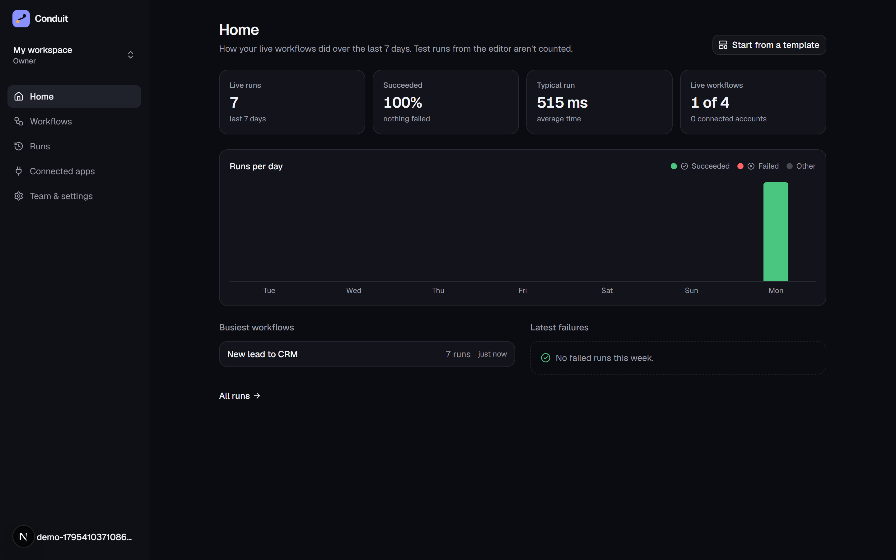
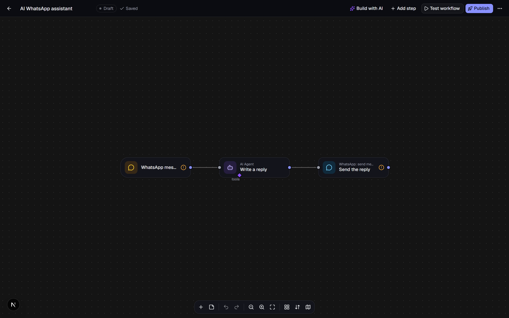

# Conduit

[](https://github.com/dexicism/conduit/actions/workflows/ci.yml)


[](LICENSE)

My own workflow automation tool, kind of like Zapier or n8n, but it runs on my laptop and costs nothing.

You drag steps onto a canvas, connect them, and hit publish. Some things I use it for:

- a Telegram bot that answers messages with AI
- form submissions that land in a Google Sheet
- a little chat page that talks to a workflow
- scheduled jobs that send emails or create calendar events

The AI runs locally through [Ollama](https://ollama.com), so there's no API bill. There are no plans, no credits and no limits either. Everything's just free.



| Editor | Templates |
|---|---|
|  |  |

## What's in it

- **Home page:** how your live workflows did this week: runs per day, success rate, the busiest workflows and the latest failures, with a link straight to each failed run.
- **Templates:** ten ready-made workflows to start from (AI bots for Telegram and WhatsApp, a chat assistant for your site, a contact form that fills a Google Sheet, new blog posts to your phone or Discord, Telegram to Todoist, bug reports to GitHub, a newsletter sign-up, and failure alerts). Hit **Templates** on the workflows page.
- **Editor:** 50-odd kinds of steps, a settings panel for each one, a picker for pulling data from earlier steps, undo/redo, copy/paste, sticky notes, auto-layout. It auto-saves and won't let two tabs overwrite each other.
- **Version history:** every publish is saved. Open one, restore it into the editor, publish again. There's also **Download as file** and **Import** for sharing a workflow. Accounts, secret fields and auth headers are left out of the file; everything else you typed into steps goes with it, so give it a look before you post it somewhere.
- **Variables:** put things like a phone number or a sheet link in Team & settings once, then use `${['$vars']['NAME']}` in any step. Secret ones are encrypted and show up as `[hidden]` in run logs.
- **Triggers:** manual, webhook, schedule, form, chat page, Telegram, WhatsApp, "called by another workflow", and "on error".
- **Logic:** if/switch, loops, filter, merge, "only new items" (remembers what it's already seen, so a feed check every hour doesn't repeat itself), set fields, text/math/date/JSON helpers, HTTP requests, and a JavaScript step that runs in a sandbox.
- **AI:** an agent that can use tools and remember a conversation, plus classify, sentiment, moderation and "pull data out of this text" steps. There's also a chat builder: describe a workflow and it drafts it on the canvas.
- **Apps:** Telegram, Gmail, Google Sheets, Calendar and Drive, Notion, Airtable, Slack, Discord, WhatsApp Business, GitHub, Trello, Todoist, Mailchimp, ntfy (push notifications to your phone), RSS feeds, PostgreSQL and SMTP. Any app step can also be handed to the AI agent as a tool.
- **The rest:** run history with every step's input and output, teams with roles, API keys and a REST API, outgoing webhooks, an MCP server so AI assistants can read and edit workflows, and two-step sign-in.

## Running it (Windows, the easy way)

Double-click **Start Conduit** (`Start Conduit.cmd` in this folder). It starts Ollama, the database and the app, then opens http://localhost:3000. The first start takes about a minute. Two minimized "Conduit" windows stay open while it's running.

**Stop Conduit** shuts it all down. Bots and schedules only run while it's up.

## Running it by hand

You need Node 22.12 or newer. No Docker: the dev database downloads a real `mongod` the first time.

```bash
npm install
npm run db     # MongoDB on 127.0.0.1:27018, leave it running
npm run dev    # http://localhost:3000
```

Copy `apps/web/.env.example` to `apps/web/.env.local` first. The only thing you have to set is `BETTER_AUTH_SECRET`.

Sign-in is by email code. If you haven't set up email (`RESEND_API_KEY` or `SMTP_URL`), the codes show up at http://localhost:3000/dev/outbox instead.

## AI

Install Ollama, run `ollama pull qwen3:8b`, and put `AI_PROVIDER=ollama` in `.env.local`. Every AI step and the builder will use that model.

A few things I found:

- It needs around 8 GB of free memory. On my laptop (RTX 3050, 4 GB) a reply takes 4 to 8 seconds once the model is loaded.
- It's fine for single AI steps. The builder gets shaky with bigger requests: a 4-step ask once took 3.5 minutes and only added the first step. The builder panel shows which steps it actually added, so check that.
- If Ollama crashes with a "CUDA error" on an NVIDIA laptop GPU, run `setx OLLAMA_LLM_LIBRARY cuda_v12` and restart Ollama. That one took me a while.
- `npx tsx scripts/try-ollama.mts` checks that answers, tool calls and JSON output all work.

If you have a Claude API key, set `ANTHROPIC_API_KEY` instead. It's a lot smarter, but you pay per use. `AI_PROVIDER=fake` gives you a dumb rule-based model for poking around without either.

## Connecting apps

Saved accounts are encrypted. In dev the key is created for you in `.data/encryption.key`. In production, set `CONDUIT_ENCRYPTION_KEY` (32 random bytes, base64) and use the same one everywhere the app runs.

**Telegram:** make a bot with @BotFather and paste its token under Connections. On your own PC the app polls Telegram for new messages, so you don't need a public address. `scripts/telegram-ai-bot.mts` sets up an "AI replies to messages" bot in one go.

**Google (Gmail, Sheets, Calendar, Drive):**

1. Make a project in Google Cloud and enable the Gmail, Sheets, Calendar and Drive APIs.
2. Set up the OAuth consent screen. Leave it in "Testing" and add yourself as a test user.
3. Create an OAuth client ("Web application") with this redirect URI: `http://localhost:3000/api/credentials/oauth/callback`
4. Put the client ID and secret in `.env.local` as `CONNECT_GOOGLE_CLIENT_ID` and `CONNECT_GOOGLE_CLIENT_SECRET`.

Google logs test apps out every 7 days. When that happens, hit **Reconnect** under Connections. Drive can only see files Conduit made itself, which is on purpose. The `scripts/try-google-*.mts` scripts check each Google service against your real account.

**WhatsApp:** uses Meta's official Cloud API, so it stays within WhatsApp's rules (unofficial WhatsApp Web bots can get a number banned). Meta's test number is free and can message up to 5 numbers you verify.

1. Make an app at developers.facebook.com, add WhatsApp, and copy the Phone number ID and an access token from API Setup. Connect it under Connections.
2. Sending works right away. For receiving, Meta needs a public address, so start a Cloudflare tunnel (below) and set `PUBLIC_URL`.
3. Hit **Receive messages** on the connection. Add the App secret and a verify token you make up (the key button), then paste the callback URL and the same verify token into Meta (WhatsApp, Configuration) and subscribe to `messages`.
4. Use the "AI WhatsApp assistant" template, or any workflow that starts with "WhatsApp message".

Replies within 24 hours of a customer's message are free-form. After that WhatsApp only allows approved templates, which the send step supports.

**Everything else** just needs a key pasted under Connections. The connect dialog says where to find it for each app, but roughly:

- **Notion:** make an internal integration at notion.so/profile/integrations, then add it to each database (••• → Connections). Without that last bit you get "not found".
- **Airtable:** a personal access token with the `data.records` scopes and access to your base.
- **Discord:** a channel webhook URL (Server Settings → Integrations → Webhooks). @mentions are switched off by default so a workflow can't ping @everyone by accident.
- **GitHub:** a fine-grained token with Issues: read and write.
- **Trello:** an API key from a Power-Up, plus a token. The list ID hides in any card's URL with `.json` on the end.
- **Todoist:** your API token from Settings → Integrations → Developer.
- **Mailchimp:** an API key. Adding someone who's already on the list just updates them, so re-running is safe.
- **ntfy:** nothing to sign up for. Install the ntfy app, subscribe to a hard-to-guess topic, and send to it.
- **RSS:** no account at all. Put it after a schedule to watch a blog.

**Webhooks and forms from the internet:** your laptop isn't reachable from outside, so run a free Cloudflare tunnel with `cloudflared tunnel --url http://localhost:3000` and put the address it prints into `PUBLIC_URL`. The address changes every time, and anyone with the link can reach your sign-in page, so close the tunnel when you're done.

## Running it for real

In dev, workflows run inside `npm run dev`. On a server you'd run the worker on its own (`npm start -w worker`, as many copies as you want) and set `CONDUIT_WORKER=off` on the web side. Jobs are claimed with a lease, so two workers never run the same thing.

By default each workspace runs up to 4 workflows at once (`WORKSPACE_CONCURRENCY`) and keeps run logs for 7 days (`EXECUTION_RETENTION_DAYS`). HTTP steps can't hit private network addresses unless you set `HTTP_ALLOW_PRIVATE_NETWORK=1`. If it sits behind a reverse proxy, set `TRUST_PROXY=1` so the chat page can rate-limit by IP.

## Tests

GitHub Actions runs the typecheck, lint and unit/integration tests on every push and pull request. The browser tests need a running app, so they run locally.

```bash
npm test            # unit and integration tests
npm run typecheck
npm run e2e         # Playwright; needs `npm run db` running, starts its own app on :3100
```

The tests use fake versions of every app (`packages/runtime/src/testing/fake-apis.ts`), so they run offline and never touch real accounts. Telegram, the Google apps and ntfy have also been checked for real (`scripts/try-*.mts`); WhatsApp, Notion, Airtable, Discord, GitHub, Trello, Todoist and Mailchimp so far only against the fakes.

## Where things live

```
apps/web          the Next.js app: pages, API routes, MCP server
apps/worker       the standalone worker for production
packages/core     shared types, schemas, graph validation
packages/nodes    the step definitions (fields, inputs, outputs)
packages/engine   runs a workflow graph step by step (no I/O, easy to test)
packages/runtime  database, job queue, triggers, sandbox, app integrations, AI providers
scripts           start/stop scripts, the dev database, "try it for real" scripts
docs              how it works, the database, the API
```

More detail in [docs/how-it-works.md](docs/how-it-works.md).
